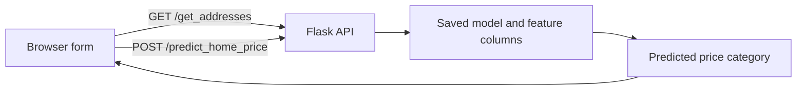

# Tehran Home Price Prediction

A browser-based machine-learning application for classifying Tehran residential properties into price categories based on their features. The project combines an interactive web interface, a Flask API, and a trained Decision Tree classifier.

Users can enter property characteristics, including area, neighborhood, number of rooms, parking, storage, and elevator availability, to obtain a predicted price category.

## How it works



## Project structure

- `THP/client/` — HTML, CSS, and JavaScript interface
- `THP/server/server.py` — Flask endpoints for listing neighborhoods and requesting a prediction
- `THP/server/util.py` — feature preparation and model loading
- `THP/server/artifacts/` — serialized model and feature-column metadata used by the API
- `THP/model/DS.ipynb` — exploratory model-development notebook

## Run locally

Use Python 3 and run the Flask server from its own directory so that the relative artifact paths resolve correctly.

```bash
cd THP/server
python -m venv .venv
source .venv/bin/activate
# On Windows: .venv\\Scripts\\activate
python -m pip install flask numpy scikit-learn
python server.py
```

Then open `THP/client/app.html` in a browser. The interface sends requests to the local Flask server at `http://127.0.0.1:5000`. Keep the server running while using the interface.

## API endpoints

- `GET /get_addresses` — returns the neighborhoods supported by the saved model.
- `POST /predict_home_price` — accepts property features and returns a predicted price category through the `estimated_price` response field.

## Project Overview

This project demonstrates an end-to-end machine-learning application, combining property data preprocessing, model development, and deployment through a Flask API and browser-based interface.

The model assigns residential properties to five price categories: Very Low, Low, Medium, High, and Very High.

## Technologies

Python · Flask · NumPy · scikit-learn · HTML · CSS · JavaScript · Jupyter Notebook
