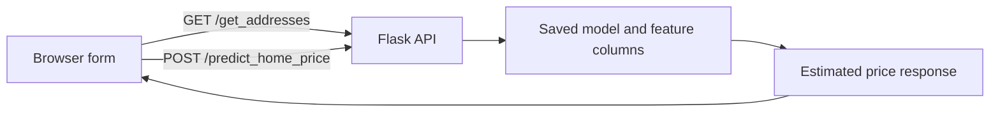

# Tehran Home Price Prediction

A browser-based machine-learning demo for estimating Tehran home prices from property features. This was developed as an undergraduate software-engineering project and combines a small web interface, a Flask API, and a saved scikit-learn model.

The app accepts property area, neighborhood, number of rooms, parking, storage, and elevator availability, then returns the model's estimated price.

## How it works



## Project structure

- `THP/client/` — HTML, CSS, and JavaScript interface
- `THP/server/server.py` — Flask endpoints for listing neighborhoods and requesting a prediction
- `THP/server/util.py` — feature preparation and model loading
- `THP/server/artifacts/` — serialized model and feature-column metadata used by the API
- `THP/model/DS.ipynb` — exploratory model-development notebook

## Run locally

Use Python 3 and run the Flask server from its own directory so that the relative artifact paths resolve correctly.

```bash
cd THP/server
python -m venv .venv
source .venv/bin/activate
# On Windows: .venv\\Scripts\\activate
python -m pip install flask numpy scikit-learn
python server.py
```

Then open `THP/client/app.html` in a browser. The interface sends requests to the local Flask server at `http://127.0.0.1:5000`. Keep the server running while using the interface.

## API endpoints

- `GET /get_addresses` — returns the neighborhoods supported by the saved model.
- `POST /predict_home_price` — accepts `total_sqm`, `address`, `room`, `parking`, `warehouse`, and `elevator`, and returns `estimated_price`.

## Limitations and reproducibility

- The repository includes serialized model artifacts, but the original data source, data license, training/validation split, and evaluation protocol are not documented well enough to substantiate a general accuracy claim.
- The saved model was not re-trained or independently validated as part of this repository cleanup. Predictions should be treated as outputs of an educational prototype, not as current market valuations or financial advice.
- The exact Python and scikit-learn versions used to create the pickle are not pinned. If model loading fails, the environment may need to match the model's original training environment.
- Neighborhood coverage and estimates are limited to the features and locations represented in the saved model.

## Technologies

Python · Flask · NumPy · scikit-learn · HTML · CSS · JavaScript · Jupyter Notebook
